

# 🎯 Job Application Tracker

[English](README.md) · 简体中文

**为软件工程师打造的自托管求职申请追踪器。 
不用 AI。不上云。无需账号。不追踪你。**

看板、招聘顾问 CRM、面试轮次、跟进提醒、Offer 并排对比，还有一张展示整个求职过程的桑基图。数据存放在你自己硬盘上的一个文件夹里，可选自动 git 备份。

🔒 运行在 localhost · 🗂️ SQLite + 纯文本 JSONL 和 Markdown · 🔁 自动 git 快照 · 📦 Apache-2.0

**[🌐 网站](https://waddington.github.io/job-application-tracker/) · [📖 用户指南](docs/guide/README.md) · [🚀 快速上手](#-快速上手) · [🤝 参与贡献](CONTRIBUTING.md)**

⭐ **如果你不想把自己的求职记录放在别人的云上，请给这个仓库点个 Star，这能帮更多人找到它。**

---

## 这是什么？

> 🌐 **应用本身也有完整的简体中文界面，不只是这份 README。** 页面、按钮、提示和日期都已译成中文，详见[语言](#-语言)。

**Job Application Tracker**（求职申请追踪器）是一个开源、自托管的 Web 应用，用来管理你的求职。它运行在你自己的电脑上，数据保存在一个由你掌控的文件夹里。它是照着技术岗招聘的真实情况设计的：

- 🧑‍💼 **一位招聘顾问会给你推荐好几个职位。** 记录每一位招聘顾问和每一家猎头公司、他们的联系方式，以及你和他们的每次通话。记下他们推荐的职位，然后逐个投递、标为感兴趣或放弃，还能看到他们替你递交过的每一个职位。
- 🔀 **申请流程多阶段，又很杂乱。** 初筛 → 技术面 → 离线作业 → 终面 → Offer。阶段可以自定义，每次变动都记下时间。
- 📝 **各种细节散落各处。** 通话、面试和职位的笔记，Google Doc 链接，PDF，导出的邮件，还有你实际发出的那一版简历和求职信：全都集中在一处。
- ⏰ **事情常常没了下文。** 首页“今日”按你要怎么处理来整理一切：“轮到你”（待读回复、到期的跟进、你的待办）、“即将进行”的事，以及“等待对方”的事，其中也包括停滞的申请。“时间线”展示所有公司、所有联系人发生过的每一件事。
- 📊 **你想知道什么做法有效。** 桑基图展示申请的去向，还有各阶段的转化率和停留时间、直投与猎头的结果对比，以及每位招聘顾问和每家猎头公司的评分卡。

## 🔒 你的数据，只属于你

- **不用 AI。** 没有任何东西会读取、总结、打分或上传你的笔记、简历和邮件。
- **不上云，无需账号。** 它运行在 `localhost` 上。没有我们的服务器接收你的数据，也没有什么需要注册。
- **不追踪你。** 没有遥测，也没有统计分析。应用从不发送邮件，从不联系任何人，也从不访问网络。
- **你的文件，开放的格式。** 代码之外的一个文件夹：一个 SQLite 数据库，加上一份纯文本导出（JSON Lines 和 Markdown 笔记），不用这个应用也能读。
- **备份很简单。** 把这个文件夹设为 git 仓库，每次改动都会自动生成快照；`jat push` 会把它推送到你自己的私有远程仓库。也可以直接下载一个 zip 文件。
- **不抓取数据。** 它记录的是**你**投出的申请，不是求职搜索引擎。

## 📸 截图

*下面所有的人名和公司都是虚构的演示数据（`scripts/seed_demo.py --lang zh-CN`）。*

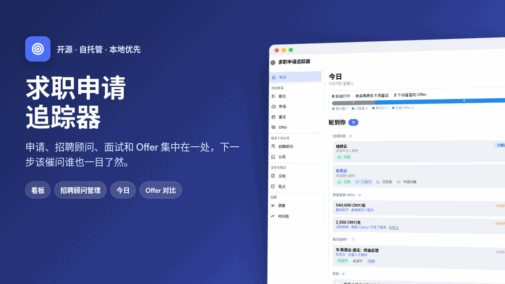

**首页“今日”。** 所有需要你处理的事，按你要怎么处理来整理：**轮到你**（待读回复、待答复的 Offer、情况如何？、待办、跟进、待决定的职位）、**即将进行**（面试、通话和有日期的待办）以及**等待对方**（你在等谁回复，哪些久无进展），上方是一行数字和按阶段分布的进行中申请。每一项都是一张卡片，大多数卡片的按钮平时颜色很淡，鼠标移上去才清楚显示。

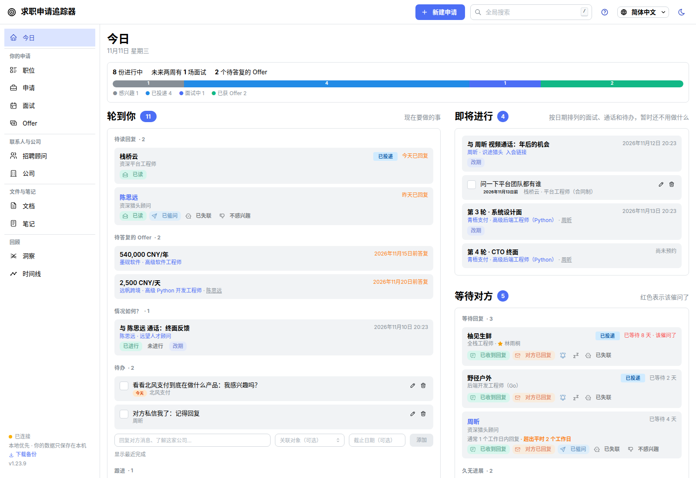

**看板。** 在阶段之间拖动申请，一眼看出哪些久无进展（红色），以及每份申请进行到了第几轮面试。

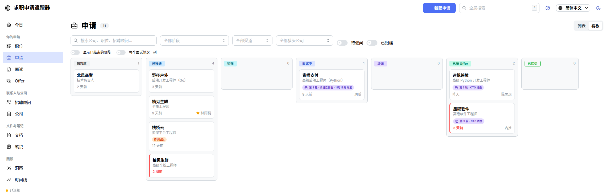

**洞察：全貌。** 一张桑基图涵盖每一个职位：从它的来源（通过猎头、内推，或你自己找到的），到放弃、待决定，或者投递后走到了哪一步；每个阶段之后紧接着是仍在等待的部分：决定是否投递、等待回复、仍在面试、考虑 Offer。第二个标签页只看申请，可以按渠道筛选。两者都能选择日期范围，鼠标悬停即可看到数字。

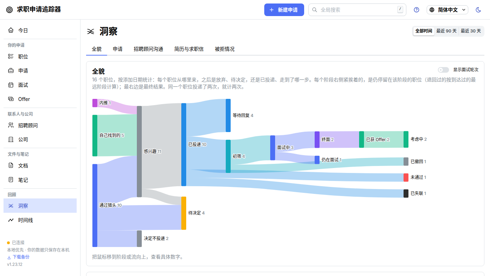

<b>更多截图</b>：等待对方、招聘顾问的页面、职位、时间线、一份申请、洞察、简历对比、Offer 和搜索

**等待对方。** 你已回复、正在等对方回复的人（超过所在阶段允许的时长就变红，并显示每个人通常多久回复），以及久无进展的申请。已收到回复、跟进、延后或标为已失联，都只需点一下。

**招聘顾问、和他们的通话，以及他们推荐的职位。** 约一次带议程的通话，记下聊得怎么样，添加对方提到的职位，然后逐个投递、标为感兴趣或放弃。每位联系人都有这样一个页面，页面上的**时间线**按钮会按时间顺序列出和对方的通话、推荐、申请和笔记。

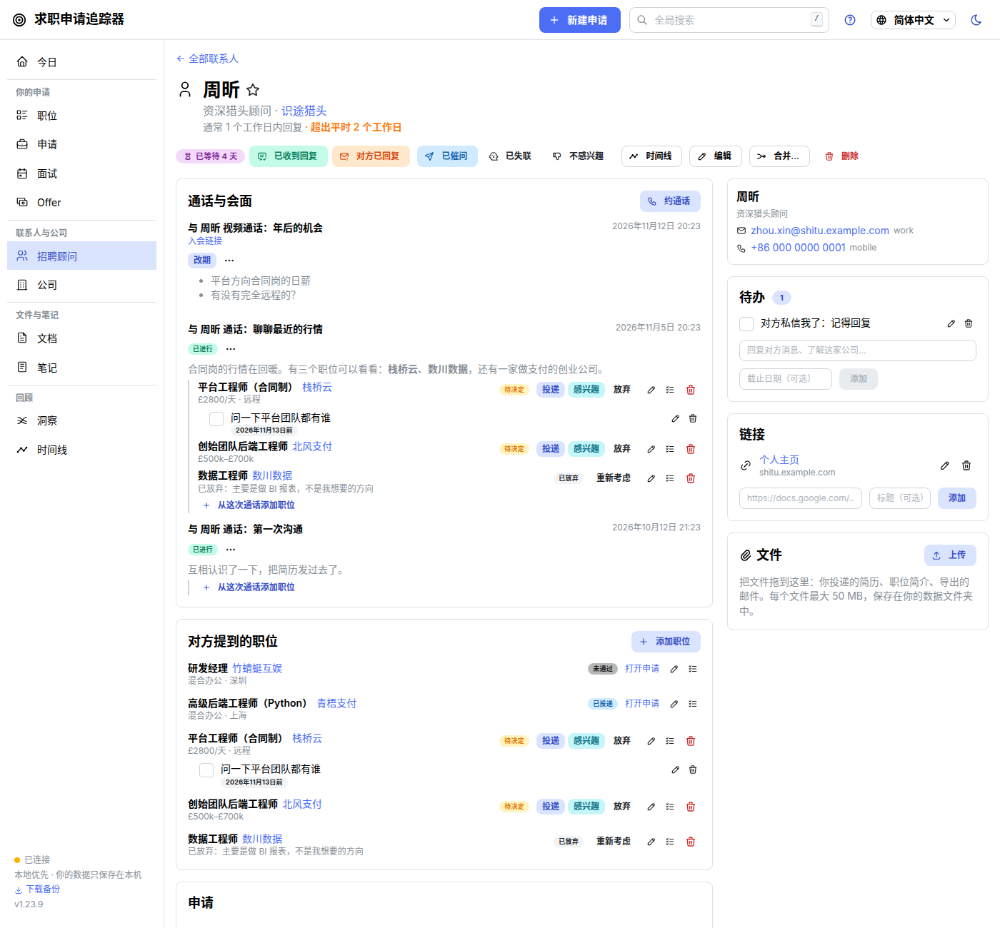

**待决定的职位。** 投递之前，所有你可能会考虑的职位。**投递**会通过推荐它的人创建申请；**感兴趣**先记录下来，暂不投递；**放弃**会保留你的理由。每个职位都有自己的页面：把职位描述拖到页面上，之后它会跟着这个职位进入你的申请。

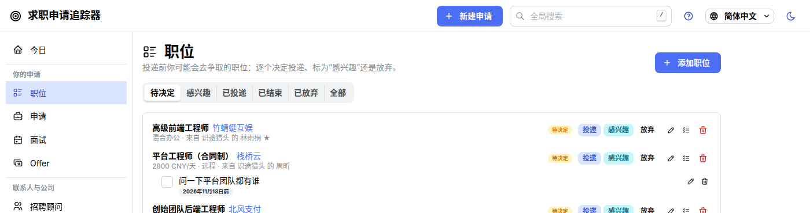

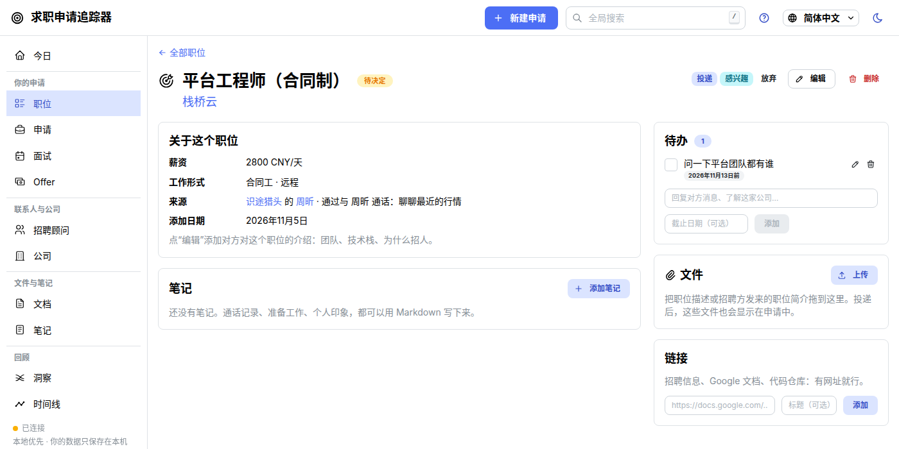

**一切尽在时间线。** 通话、推荐和放弃的职位、阶段变动、消息、面试、Offer 和笔记，可以按天列出，也可以用泳道按时间排开：每个职位一行，从提到它的那次通话一直看到最终结果。

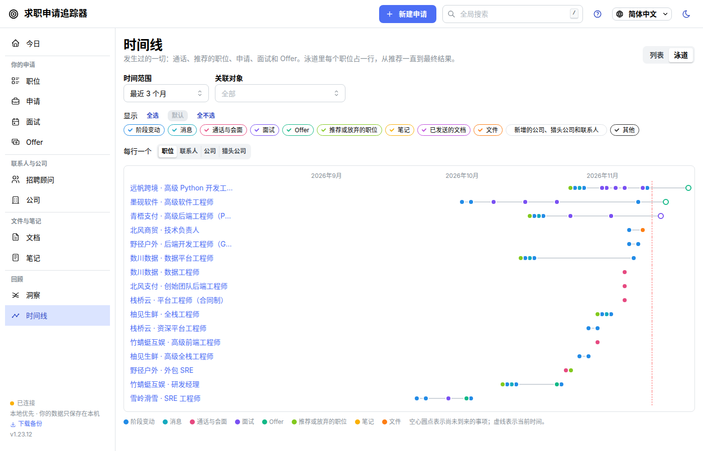

**一份申请的所有信息都在一处。** “概览”告诉你它需要什么，以及每件事过去了多久（“久无进展：12 天无动态”“3 周前投递”）。下面是用你自己的话描述的面试轮次（“第 3 轮 · 系统设计测试”）、你发出的简历版本、Markdown 笔记、链接、文件和导出的邮件，以及带时间戳的完整历史。

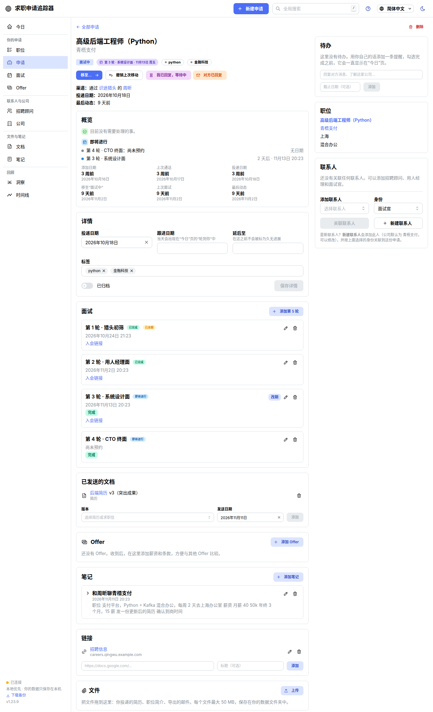

**转化率、阶段停留时间、直投与猎头对比，以及招聘顾问评分卡。** 你在哪些阶段容易卡住，猎头和直投哪种对你更有效，哪些招聘顾问推荐的职位真的有下文。

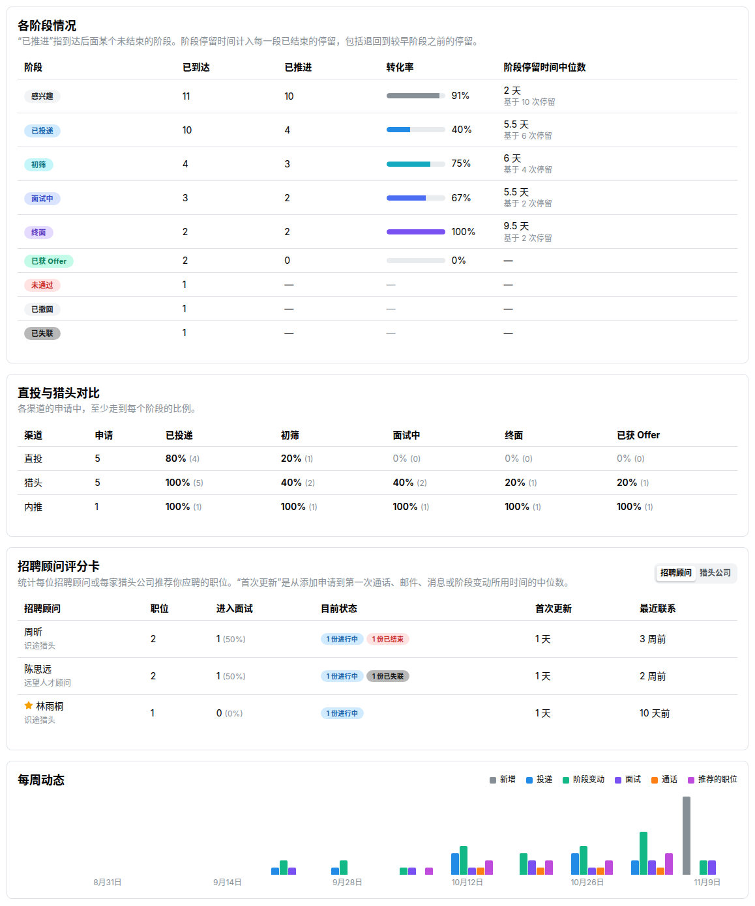

**与招聘顾问的沟通：申请之前发生了什么。** 进行过的通话、每位招聘顾问推荐的职位、你投递或放弃了哪些（以及原因）、这些申请后来怎样，用数字、桑基图和按人或按猎头公司的表格呈现。

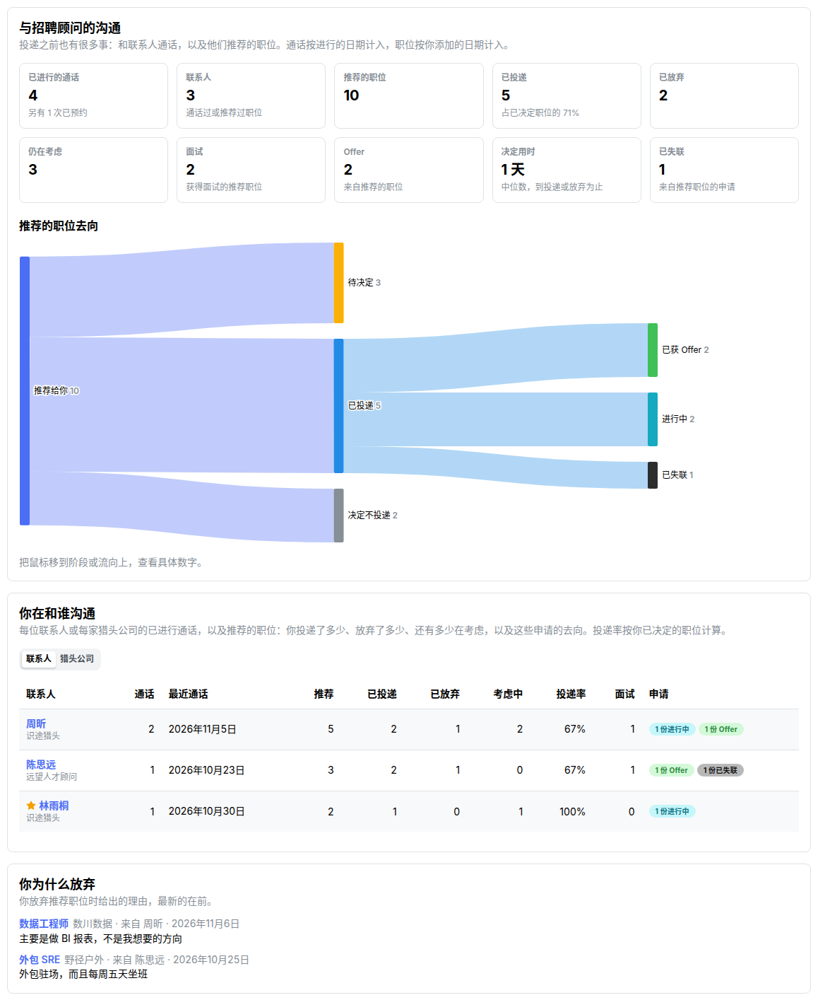

**哪个版本的简历效果最好？** 对简历和求职信的各个版本做 A/B 测试：多少份收到了回复、进入了初筛或面试、拿到了 Offer，以及每个数字的可信度。选两个版本对比，它会告诉你差别很可能是真的，还是可能只是偶然。简历是以普通文件附在申请、职位或招聘顾问上的？它能找出相同的文件，把每一份变成一个版本。

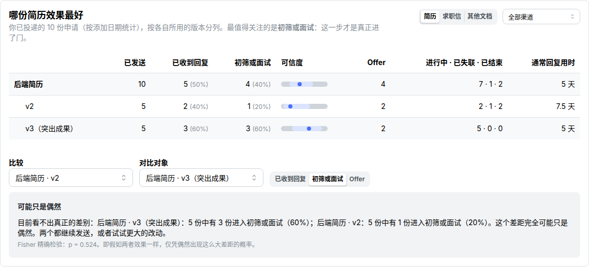

<table>
<tr>
<td width="50%"><b>申请列表</b>，可按渠道、阶段、轮次和久无进展筛选 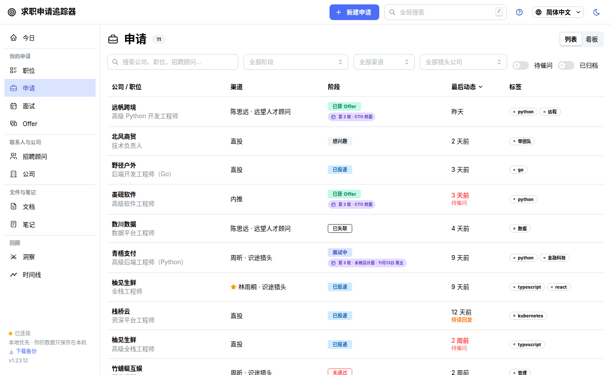</td>
<td width="50%"><b>招聘顾问 CRM</b>：猎头公司、招聘顾问，以及联系他们的每一种方式 </td>
</tr>
<tr>
<td width="50%"><b>简历和求职信的版本</b>，以及每个版本发给了哪里 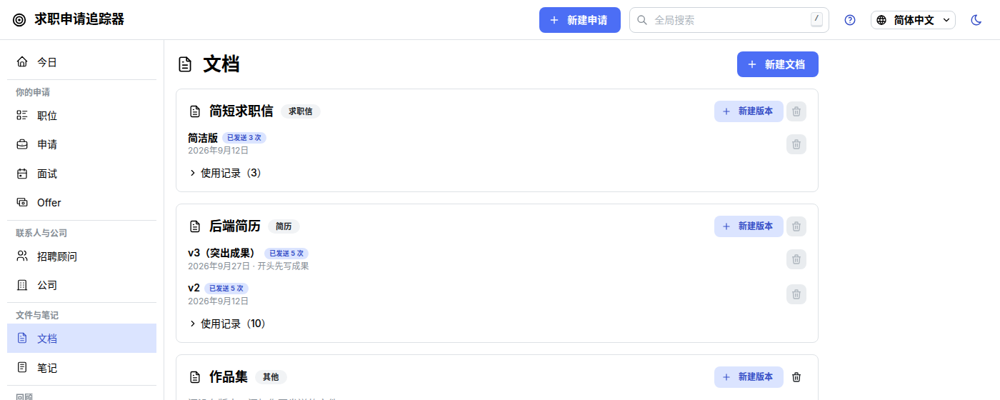</td>
<td width="50%"><b>Offer 并排对比</b>：正式岗的薪资方案对比合同工的日薪，年度总值排在最前 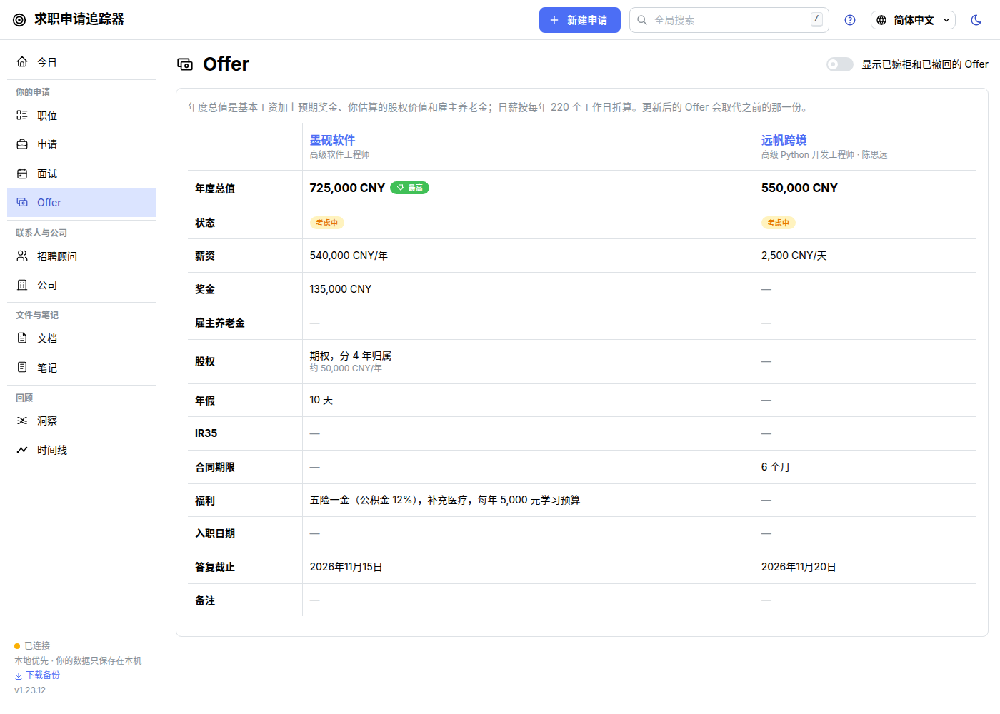</td>
</tr>
<tr>
<td width="50%"><b>全局搜索</b>（按 <kbd>/</kbd>）：申请、联系人、笔记、复盘、通话、邮件 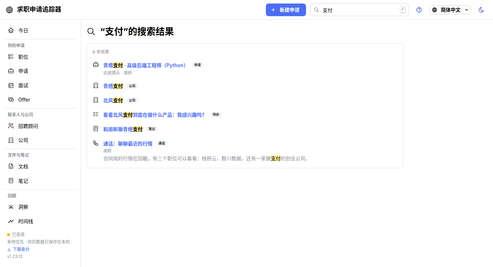</td>
<td width="50%"></td>
</tr>
</table>

